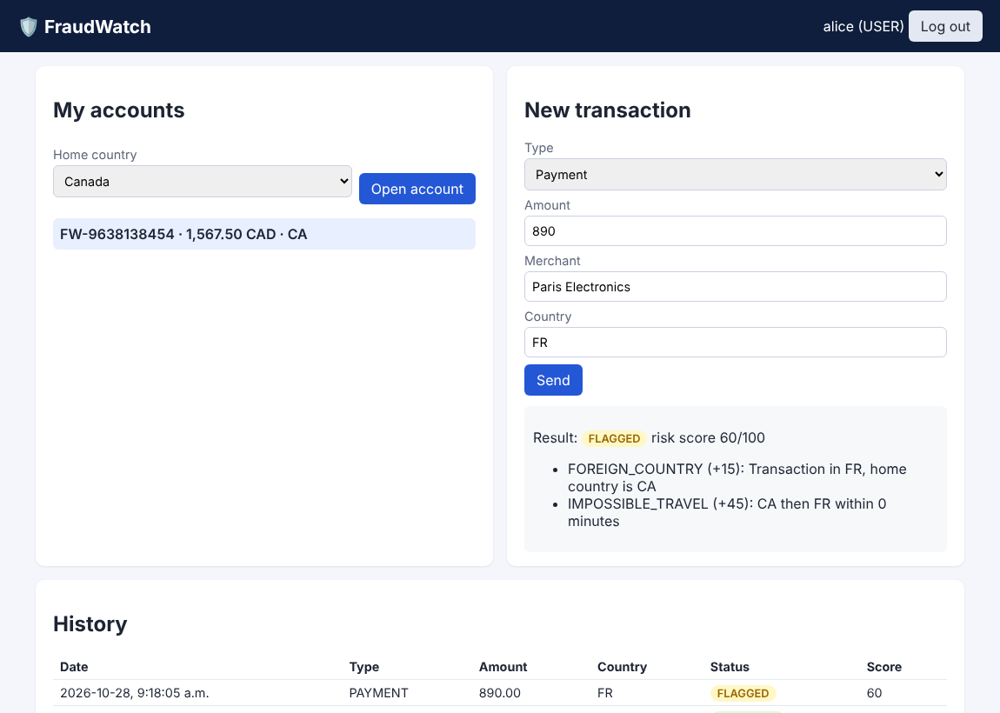
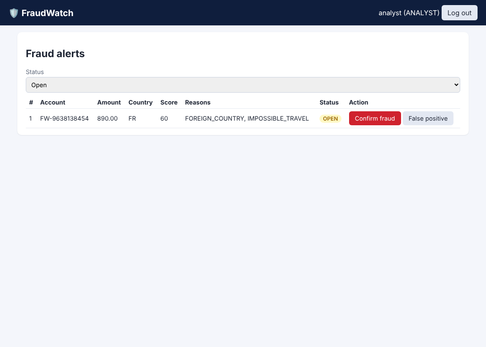
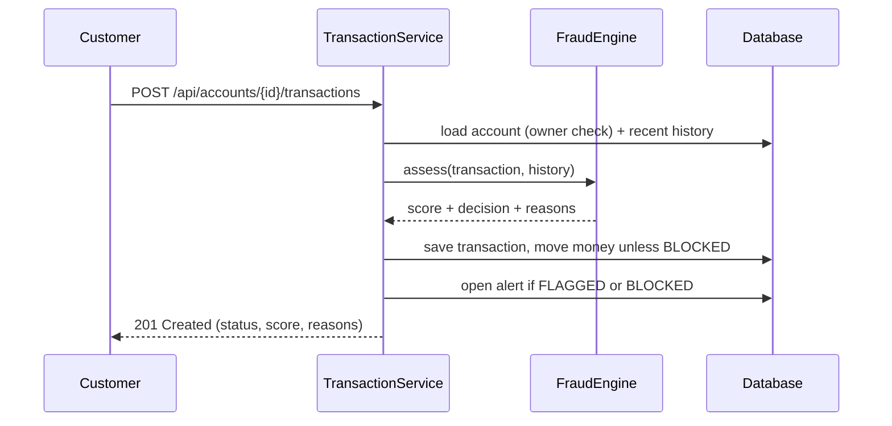

# FraudWatch API

A banking REST API that scores every transaction for fraud **in real time**, and decides to approve it, flag it for review, or block it.
Built with Java 21 and Spring Boot 3.

> 🇫🇷 API bancaire qui évalue chaque transaction en temps réel et décide de l'approuver, de la signaler à un analyste ou de la bloquer.


| Customer view | Analyst view |
|---|---|
|  |  |

## What it does

1. A customer opens an account and makes transactions (deposits, payments, withdrawals).
2. Each transaction goes through a **rule engine** that adds up risk points:

   | Rule | Signal | Points |
   |---|---|---|
   | `LARGE_AMOUNT` | Amount ≥ 10 000 | 40 |
   | `UNUSUAL_AMOUNT` | More than 5× the account's average (needs 3+ past transactions) | 30 |
   | `VELOCITY` | 6th transaction within 10 minutes | 35 |
   | `FOREIGN_COUNTRY` | Outside the customer's home country | 15 |
   | `IMPOSSIBLE_TRAVEL` | Different country than the previous transaction, less than 2 h ago | 45 |
   | `NIGHT_ACTIVITY` | Between midnight and 5 a.m. (Montreal time) | 10 |

3. The score (capped at 100) decides what happens:

   | Score | Decision | Money |
   |---|---|---|
   | 0-39 | `APPROVED` | moves |
   | 40-69 | `FLAGGED` + alert | moves, an analyst reviews it |
   | 70-100 | `BLOCKED` + alert | does not move until an analyst releases it |

4. Fraud analysts review the alert queue and close each alert as `CONFIRMED_FRAUD` (a flagged payment is reversed) or `FALSE_POSITIVE` (a blocked payment is released).

All thresholds live in `application.yml`, so they can be tuned without touching the code.

## Security

- **JWT authentication** (HMAC SHA-256), stateless, one-hour tokens, expiry and issuer checked on every request
- **Role-based access**: `USER` (customer), `ANALYST` (alert queue), `ADMIN` (audit log), deny-by-default for any other route
- **Brute-force protection**: a username is locked for 15 minutes after 5 failed logins (`423 Locked` + `Retry-After`)
- **No user enumeration**: same error and same response time for a wrong password and an unknown username
- **IDOR protection**: someone else's account returns `404`, as if it did not exist
- **BCrypt** password hashing, passwords never logged or returned
- **Audit log** of logins, failures, lockouts, transactions and alert reviews
- **Input validation** on every request, clean RFC 7807 error bodies, no stack traces leaked
- Content Security Policy on the demo UI, values inserted with `textContent` only (no XSS)

## Tech stack

| Area | Tools |
|---|---|
| Language | Java 21 |
| Framework | Spring Boot 3.3 (Web, Security, Data JPA, Validation, Actuator) |
| Auth | Spring Security OAuth2 Resource Server, JWT |
| Database | PostgreSQL (Docker) or H2 in memory (default), Flyway migrations, hand-written SQL reports |
| Docs | OpenAPI 3, Swagger UI |
| Tests | JUnit 5, AssertJ, Mockito, MockMvc, JaCoCo coverage |
| DevOps | Docker (multi-stage, non-root), Docker Compose, GitHub Actions |

## Architecture

```
com.fraudwatch
├── fraud/        Rule engine: pure Java, no Spring, no database (easy to test)
│   └── rules/    One class per rule
├── transaction/  Creates transactions, asks the engine, moves the money
├── alert/        Analyst review queue
├── account/      Bank accounts (ownership checks)
├── auth/         Sign-up, login, JWT, brute-force protection
├── audit/        Security audit log
├── user/         Users and roles
├── config/       Spring wiring: security, fraud settings, Swagger, demo data
└── common/       Error handling
```



The fraud engine has **no dependency on Spring or the database**: it receives a `TransactionContext` and returns a `FraudAssessment`.
Adding a rule means adding one class that implements `FraudRule`.

## Run it

**Option 1: Maven only (H2 in-memory database)**

```bash
mvn spring-boot:run
```

**Option 2: Docker Compose (PostgreSQL)**

```bash
docker compose up --build
```

Then open:

- Demo UI: http://localhost:8080
- Swagger UI: http://localhost:8080/swagger-ui.html
- Health: http://localhost:8080/actuator/health

Demo accounts created at startup: `analyst` / `Analyst123!` and `admin` / `Admin123!`. Customers sign up from the UI or the API.

## Try a fraud scenario (curl)

```bash
# 1. Sign up and log in
curl -s -X POST localhost:8080/api/auth/register -H 'Content-Type: application/json' \
     -d '{"username":"alice","password":"Password123"}'
TOKEN=$(curl -s -X POST localhost:8080/api/auth/login -H 'Content-Type: application/json' \
     -d '{"username":"alice","password":"Password123"}' | jq -r .accessToken)

# 2. Open an account
curl -s -X POST localhost:8080/api/accounts -H "Authorization: Bearer $TOKEN" \
     -H 'Content-Type: application/json' -d '{"homeCountry":"CA","currency":"CAD"}'

# 3. Deposit in Canada, then pay in France a minute later
curl -s -X POST localhost:8080/api/accounts/1/transactions -H "Authorization: Bearer $TOKEN" \
     -H 'Content-Type: application/json' -d '{"type":"DEPOSIT","amount":1000,"country":"CA"}'
curl -s -X POST localhost:8080/api/accounts/1/transactions -H "Authorization: Bearer $TOKEN" \
     -H 'Content-Type: application/json' -d '{"type":"PAYMENT","amount":50,"merchant":"Cafe","country":"FR"}'
# -> "status":"FLAGGED","riskScore":60, triggeredRules: FOREIGN_COUNTRY, IMPOSSIBLE_TRAVEL
```

## SQL reports

[`sql/`](sql/) holds eight PostgreSQL reports on the same database: daily review rate, **precision of each fraud rule**, analyst review times, the open queue, a running-balance statement (window functions), a **balance reconciliation**, the impossible-travel rule recomputed with `LAG()` and checked against the engine, and brute-force detection from the audit log. A demo data set and a CI job (`sql/check.sh`) come with them.

## Tests

```bash
mvn verify        # unit + integration tests, coverage report in target/site/jacoco/index.html
```

- `FraudRulesTest`, `FraudEngineTest`: every rule and threshold, including edge cases (exact threshold, empty history, time zones)
- `TransactionServiceTest`: service logic with Mockito (money movement, alerts, insufficient funds)
- `AuthApiTest`, `SecurityApiTest`, `TransactionFlowApiTest`: full HTTP scenarios against the running app
- A controllable clock makes time-based rules deterministic (no flaky tests at night)

An independent black-box test suite (API, UI and load tests) lives in [fraudwatch-qa](https://github.com/florianeagbanou/fraudwatch-qa).

## API overview

| Method | Path | Role |
|---|---|---|
| POST | `/api/auth/register` | public |
| POST | `/api/auth/login` | public |
| GET, POST | `/api/accounts` | USER |
| GET | `/api/accounts/{id}` | USER (owner) |
| GET, POST | `/api/accounts/{id}/transactions` | USER (owner) |
| GET | `/api/alerts?status=OPEN` | ANALYST, ADMIN |
| PATCH | `/api/alerts/{id}` | ANALYST, ADMIN |
| GET | `/api/audit?limit=50` | ADMIN |

Full, interactive documentation in Swagger UI.

## Possible next steps

- Store login attempts in Redis to support several API instances
- Refresh tokens and token revocation
- Machine-learning score alongside the rules
- Testcontainers to run the integration tests against PostgreSQL

## Author

Floriane Jessica Agbanou · [LinkedIn](https://www.linkedin.com/in/florianeagbanou)
